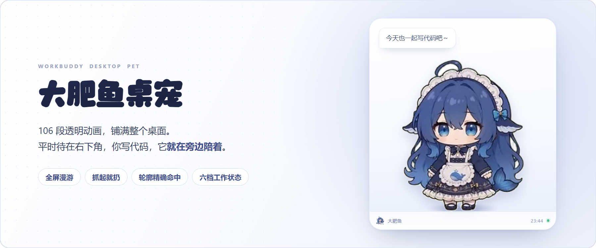
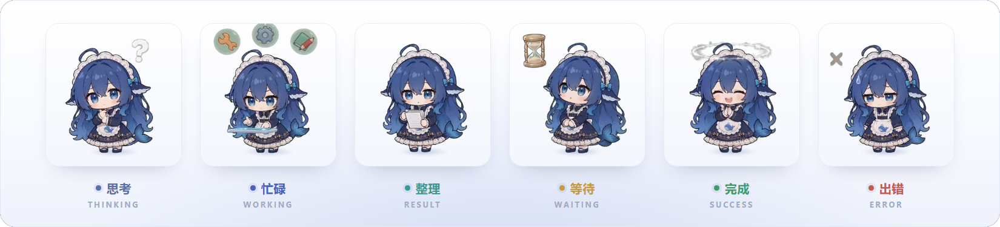
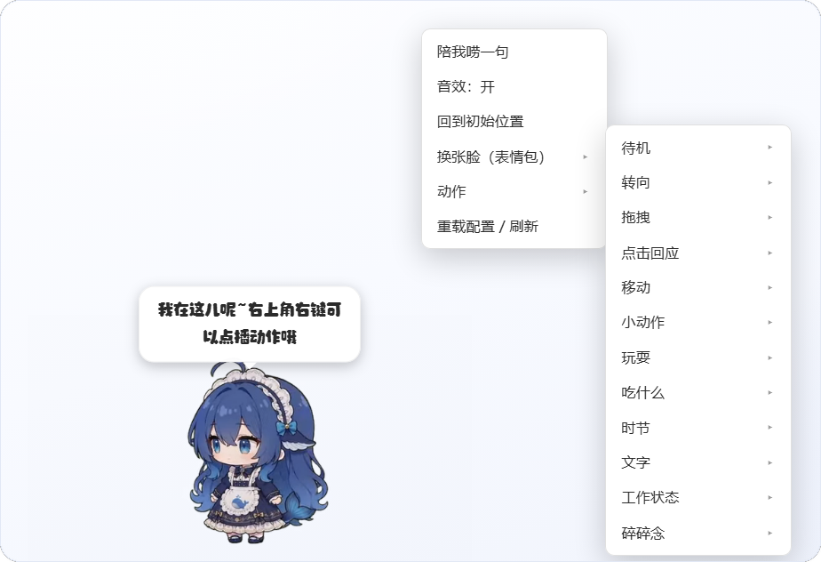

# 大肥鱼 · 桌面宠物

<p align="center">
  
</p>

<p align="center">
  
  &nbsp;
  
  &nbsp;
  
</p>

<p align="center">
  106 段透明动画、全屏漫游、能拖能甩的一只小鱼，住在你的 Windows 桌面右下角。<br>
  你写代码时它陪着，你出错时它会叹气。
</p>

---

## 30 秒上手

**① 双击 `安装.bat`**

第一次运行会自动从国内镜像（npmmirror）拉 Electron 运行时（约 100MB，一般 20 秒内），
装到 `runtime/electron/` 并直接启动。装完之后就是秒开，**不用再手动下载任何东西**。

> 只有 Windows 10 1803 及以上能自动装（要用系统自带的 `curl` 和 `tar`）。
> 更老的系统看下面「装不上怎么办」。

**② 以后双击 `启动桌宠.vbs`**

| 双击 | 什么时候用 |
| --- | --- |
| `启动桌宠.vbs` | 平时用这个，无窗口静默启动 |
| `启动桌宠.bat` | 出问题时用，能看到日志 |
| `安装.bat` | 换电脑 / 重装 / 运行时丢了，再跑一次即可 |

**装不上怎么办**

`安装.bat` 会告诉你是下载失败还是解压失败。下载失败可以直接手动拿运行时：
[electron-v38.8.6-win32-x64.zip](https://github.com/electron/electron/releases/tag/v38.8.6)
（或国内镜像 `https://registry.npmmirror.com/-/binary/electron/38.8.6/electron-v38.8.6-win32-x64.zip`），
解压后把里面所有文件放进 `runtime/electron/`，该目录下要能直接看到 `electron.exe`。

**③ 摸一下它**

- **右键鱼身** → 多级菜单，动画随便点播
- **托盘图标** → 回家 / 说句话 / 开机自启 / 退出
- <kbd>Ctrl</kbd>+<kbd>Alt</kbd>+<kbd>P</kbd> 收起或叫出来，<kbd>Ctrl</kbd>+<kbd>Alt</kbd>+<kbd>Q</kbd> 退出

> 它不占任务栏、不抢焦点，切到任何程序它都在。**找不到就去右下角托盘**。

## 它长什么样

<p align="center">
  
</p>

六档状态各有专属动画和特效道具（问号、工具、沙盒、沙漏、星星、叉），也可以跟着你的任务进度自动切换。
下面这张是**真跑起来的画面**，不是画出来的示意图：

<p align="center">
  
</p>

## 能做什么

| 能力 | 说明 |
| --- | --- |
| **100+ 透明动画** | `assets/webm/` 里 106 段 VP9-alpha 动画：待机呼吸、玩魔方、涮火锅、打瞌睡…… |
| **动画链** | 每段播完按权重抽下一个（idle 10 / 转向 5 / 移动 5 / 小动作 80），双缓冲交叉淡入，不闪黑 |
| **全屏漫游** | 能飘到屏幕任意位置（含半空），多数时候贴着底边晃；碰到边自己换方向，不会走出屏幕 |
| **只吃自己那一块鼠标** | 窗口铺满全屏但默认穿透。命中的是**角色真实轮廓**，不是矩形 |
| **拖 / 甩** | 弹簧跟手（K=200 C=30），松手按轨迹估初速，抛物线飞 + 边墙反弹 + 落地 Q 弹压扁 |
| **点击回应** | 5 种点击动画随机播，配 Q 弹挤压和音效 |
| **音效** | WebAudio 现场合成，没有音频文件：点击「啵」、开心上行双音、扔出去「咻」、落地闷响…… |
| **右键点播** | 多级菜单：动作 / 玩耍 / 吃什么 / 时节 / 文字 / 工作状态 / 碎碎念，全部可单独点播 |
| **表情包** | 27 张官方表情包，碎碎念随机配图，菜单里也能直接挑 |
| **工作状态** | 六档专属动画 + 头顶气泡，可由外部事件全自动驱动 |
| **碎碎念** | 默认 5 分钟一句，也可由外部推任意句子 |

<details>
<summary><b>「只吃自己那一块鼠标」是怎么做到的</b></summary>

给 106 段动画各生成了一张 64×36 的 alpha 轮廓掩码（`js/hitmask.js`，用 canvas 逐帧读 webm 的透明通道算出来的），
光标落在哪一格就查表决定要不要接管：**覆盖 98.5% 的角色像素、误吞 2.1%**，比矩形判定少了约四成透明死区。

所以光标从鱼旁边划过不会挡住下面的窗口，气泡弹出时也不会在你头顶压一块看不见的死区。
换素材后要重算，见下方[开发与调试](#开发与调试)里的「重算命中掩码」。

</details>

## 快捷键与托盘

| 操作 | 效果 |
| --- | --- |
| <kbd>Ctrl</kbd>+<kbd>Alt</kbd>+<kbd>P</kbd> | 藏起来 / 叫出来 |
| <kbd>Ctrl</kbd>+<kbd>Alt</kbd>+<kbd>Q</kbd> | 退出（不会自己诈尸，要它回来就再双击一次） |
| 托盘 → 显示/隐藏 | 同上 |
| 托盘 → 回家 | 回到右下角初始位置 |
| 托盘 → 说句话 | 随机碎碎念一句 |
| 托盘 → 开机自启 | 切换登录时自动启动 |

关掉窗口不会丢：**单实例**，重复双击只会把已有的叫出来。

网页版也还能用（`start.bat` 或 `node wb-pet.mjs up`），方便调试和换素材。

## 状态联动（可选）

不接事件的它就是一只普通桌宠，自己玩自己的。接上之后，一轮任务里的每个节点都会自动推状态：

| 事件 | 桌宠状态 | 动画 |
| --- | --- | --- |
| `UserPromptSubmit`（你发出指令） | thinking | 工作状态-思考冒泡 |
| `PreToolUse`（每次工具调用） | working | 工作状态-忙碌点按 |
| `PostToolUse` | result | 工作状态-清点归档 |
| `Notification`（要你确认） | waiting | 工作状态-原地踱步张望 |
| `Stop`（本轮结束） | success | 工作状态-雀跃庆祝 |

<details>
<summary><b>三种接法：钩子 / 命令行 / HTTP</b></summary>

**① 钩子（可选，默认没装）**

> 事件格式按 Claude Code 的 hooks 规范，写进 AI 工具的 `settings.json`（默认 `~/.workbuddy/settings.json`）。
> 各家支持程度不一样，所以没有默认开启；脚本会先备份，一条命令能撤销。

```bash
node install-hooks.mjs              # 写入 hooks 字段（自动备份）
node install-hooks.mjs --remove     # 一条命令撤销
```

**② 命令行**

```bash
node wb-pet.mjs state working        # thinking|working|result|waiting|success|error|idle
node wb-pet.mjs say "这行我改好了"    # 说一句（可 --image 表情包名）
node wb-pet.mjs anim "写代码"         # 点播动画
node wb-pet.mjs move "螃蟹走路"       # 走一段
node wb-pet.mjs whisper              # 立即碎碎念
node wb-pet.mjs roam                 # 全屏随便飞一下
node wb-pet.mjs home                 # 叫回右下角
```

**③ HTTP**

```bash
curl -X POST http://127.0.0.1:7715/api/state -H "content-type: application/json" -d "{\"state\":\"working\"}"
curl -X POST http://127.0.0.1:7715/api/say   -H "content-type: application/json" -d "{\"text\":\"喝口水吧\",\"image\":\"可爱\"}"
```

页面里也可以直接调 `window.wbPet.state('success')` / `say()` / `anim()` / `whisper()`。

| 方法 | 路径 | 说明 |
| --- | --- | --- |
| GET | `/api/info` | 版本 + 表情包清单 |
| GET | `/api/events` | SSE 事件流（页面自动连） |
| GET / POST | `/api/state` | 读 / 写工作状态 |
| POST | `/api/say` | 气泡说话（`text` / `image` / `ms`） |
| POST | `/api/anim` | 点播动画（`name`，加 `move:true` 走一段） |
| POST | `/api/whisper` | 立即碎碎念 |
| POST | `/api/roam` | 全屏随便飞一下 |
| POST | `/api/home` | 回到右下角并恢复待机 |
| POST | `/api/refresh` | 让页面重读配置 |

服务只监听 `127.0.0.1:7715`（`--port` 可改），不对外。

</details>

## 常驻：登录就出现，一直在

桌宠交给 Windows **计划任务 `WBPet`** 托管，登录后自动启动，跟窗口切换、软件开合都无关。

```powershell
Start-ScheduledTask -TaskName "WBPet"                              # 立即启动
Get-ScheduledTask    -TaskName "WBPet"                              # 看状态
Unregister-ScheduledTask -TaskName "WBPet" -Confirm:$false          # 彻底移除
```

`安装.bat` 会先试计划任务，建不了就退化成启动文件夹里的 `大肥鱼桌宠.vbs`，效果一样。
（别在终端里手动 `electron .` 起——那种子进程会随终端窗口被回收，鱼过一会儿就没了。）

崩了会自己回来：未捕获异常 / 渲染进程崩掉 → 自动重开一次；启动 5 秒内就崩说明是稳定错误，
就不再无脑重试。你自己点退出则不会诈尸。

<details>
<summary><b>托盘「开机自启」和计划任务是什么关系</b></summary>

两条路都能让它开机出现，任选其一：

| 方式 | 谁在用 | 特点 |
| --- | --- | --- |
| 计划任务 `WBPet` | `安装.bat` 优先注册 | 系统级托管，跟任何会话无关，最稳 |
| 启动文件夹 `大肥鱼桌宠.vbs` | 托盘开关 / 计划任务建不了时的降级 | 不需要任何权限，静默无窗口 |

托盘那个开关只写启动文件夹的 `.vbs`，不动计划任务；两个都开着也不会出现两只鱼（单实例）。

</details>

## 配置

都在 `js/config.js`：

| 键 | 管什么 |
| --- | --- |
| `pets[]` | `size`（宽度 px，高度自动 ×9/16）、`position.corner/marginX/marginY`、`fixedEnabled`（true = 不再自己走开） |
| `physics` | 重力 / 弹性 / 地面摩擦 / 顶边反弹 / 总力度 |
| `animations` | 各动作池、行走参数、随机分类与权重、事件档位 |
| `animationWeights` | 随机链权重（三项 + 各分类合计 = 100） |
| `workStatusTexts` / `whisperLines` | 气泡文案 |
| `sound` | `enabled` / `volume`（0~1） |
| `animations.moves.roamChance` | 桌面模式下"移动"改成全屏漫游的概率（默认 0.4，其余仍贴底边走） |

想换宠物形象：把新的 16:9 绿幕动画转成 VP9-alpha `.webm`，**文件名保持一致**丢进 `assets/webm/` 即覆盖。

`?bg=1` 打开带壁纸的独立窗口观感（默认背景透明）；`?menu=1` 直接展开右键菜单，方便截图排查。

## 常见问题

<details>
<summary><b>用浏览器打开时，怎么也有一只鱼？</b></summary>

那不是残影。用 `http://127.0.0.1:7715/?bg=1` 在浏览器里打开时，是**另一个独立的页面实例**，
有自己的动画链和位置。真实桌面上只有一只，位置以桌面那只为准，关掉那个标签页即可。

</details>

<details>
<summary><b>任务栏里找不到它？</b></summary>

故意的：`skipTaskbar: true`。入口在右下角托盘图标。

</details>

<details>
<summary><b>它到底占多少资源？</b></summary>

2560×1600 @165Hz + 核显实测：

| 指标 | 数值 |
| --- | --- |
| GPU 共享内存 | **44MB** |
| 提交内存 | 约 350MB（5 个进程，工作集约 130MB） |
| CPU | 3% 左右，静止时更低 |

显存这块做了三条取舍，都不是玄学：

- **窗口只覆盖工作区底部 62%**。鱼绝大多数时间贴底活动，上面那半屏基本是空的，可核显要为
  整块 per-pixel-alpha surface 留帧缓冲，桌面上任何窗口刷新也都要和这块透明层重新合成一次。
  砍掉上面 38% 之后，GPU 共享内存从 76MB 降到 44MB，整机合成的重叠面积也少了约四成。
  想让它能飞到屏幕上半部分：启动前设环境变量 `WBPET_WIN_H=1` 恢复铺满整屏。
- **位置提交限流**：取整后没变就一次都不提交，有变化也限到 45fps（拖拽时 90fps 保手感）。
- **V8 堆上限 128MB**：页面逻辑很轻，堆开太大只会让 GC 拖着不还。

> 机器整体吃紧时，先看任务管理器里真正的大户——浏览器、聊天软件、游戏客户端动辄 1GB 以上，
> 桌宠这点占用通常不是卡顿的主因。

</details>

<details>
<summary><b>关掉别的软件它还在吗？</b></summary>

在。它跟任何窗口、任何会话都无关，登录后由系统托管。不想要了就卸计划任务 + 托盘退出。

</details>

## 开发与调试

<details>
<summary><b>调试工具（靠 DevTools 协议，只在本机）</b></summary>

先带调试端口重启（临时改计划任务参数即可）：`electron.exe "...\desktop" --cdp-port=9222`

```bash
node dev/probe.mjs                                 # 读页面真实状态：宠物数量、视频位置、坐标
node dev/probe.mjs "window.wbPet.say('测试')"      # 在页面里执行任意表达式
node dev/pageshot.mjs out.png                      # 只截窗口自身（不受桌面合成影响）
```

`--selftest` 跑一遍自检并截图（`--click` 测点击与音效、`--menu` 测级联菜单坐标、`--roam` 测漫游）。

改 README 的配图或配色看 [docs/DESIGN.md](docs/DESIGN.md)：配色怎么取的、图怎么渲的、验收怎么做，都写在里面。

</details>

<details>
<summary><b>重算命中掩码</b></summary>

换素材、加动画之后必须重算，否则新动画会退回"并集"掩码（偏胖一点，但仍比矩形准）：

```bash
runtime/electron/electron.exe dev/measure.cjs --all      # 采样 106 段 webm 的 alpha，约 2~3 分钟
```

判据是「过半采样帧都有内容 + 单帧覆盖率 > 15%」，所以跳起来、伸懒腰的极端姿态不会被算进去；
过于稀疏的掩码会自动丢弃（那段动画回退到全动画并集，保证抓得住）。

</details>

<details>
<summary><b>性能采样与卡顿排查结论</b></summary>

```bash
runtime/electron/electron.exe dev/perf.cjs                            # 全流程
runtime/electron/electron.exe dev/perf.cjs --only=hit                 # 只校验命中掩码
runtime/electron/electron.exe dev/perf.cjs --only=stall --win=small   # 长任务定位 / 小窗对照
```

**结论（165Hz 屏实测）**：待机 p50 6.1ms、漫游 p50 6.1ms、jank 0。

屏幕 165Hz，Chromium 每帧都按 vsync 跑 rAF，所以"每帧改一次位置" = 每秒让这张 2560×1600 的
per-pixel-alpha 分层窗重新合成 165 次。按每帧 15.7MB 算，等于每秒往显存推 **2.6GB** 透明像素
—— 核显扛不住，整机跟着一起卡。改法是**位置提交限流**：取整后没变就一次都不提交（弹簧收敛、
原地动作不再空转），有变化也限到 45fps（拖拽 90fps 保手感），收尾强制画准。
实测每秒提交次数 **155 → 33.7**，页面仍是 155fps，肉眼无差别。

两个被实验否掉的猜测（都实测过，留个记录）：

- **改"小窗跟随"更糟**：`dev/follow.cjs` 里窗口按 120Hz 跟随，帧率从 158 掉到 122，还出现 310ms 停顿
  —— Windows 上移动透明窗同样是整张 surface 重传，并不比全屏合成便宜。
- **鼠标高频划过不是瓶颈**：250Hz 扫过鱼身，帧间隔 p95 稳定在 6.2ms（`dev/hover.cjs`）。

真正让"偶尔卡一下"变明显的是**系统内存压力**：排查时测试机只剩 0.2GB 可用、物理内存占用 98%、
页面文件 7000+ 次/秒，连一个不相关的普通窗口都会出现 394ms 停顿（`dev/solo.cjs` 对照）。
桌宠本身只占 129MB 工作集，是受害者不是元凶。

</details>

<details>
<summary><b>和原版 dsh-pet 的差异（说清楚，不藏）</b></summary>

原版是 DSH（Cordis）插件，宿主半侧 + React 客户端半侧 + Electron 透明窗。这版是独立网页 + Node 桥：

- **保留**：素材、动画链权重与抽签逻辑、移动规划（leadSec/tailSec 与距离缩放）、弹簧跟手、
  抛掷初速估算（峰值加权 + 加速度增益 + 软钳速）、反弹与落地 Q 弹曲线、点击回应、九级右键菜单、
  六档工作状态、气泡几何（全部按 `--pet-size` 等比缩放）
- **没做**：余额钱包、AI 碎碎念/对话（原版调 DSH 的模型，这边换成可外部推送 + 本地文案池）、
  多宠物互撞、多显示器（只铺主屏工作区）
- **新增**：Electron 透明置顶桌面壳（托盘 / 快捷键 / 单实例 / 开机自启）、鼠标穿透与悬停接管、
  全屏漂浮漫游、WebAudio 合成音效、SSE 事件通道、状态联动安装器、CLI
- **一处取舍**：原版是「窗口跟着宠物走」的局部小窗（注释里提到全屏透明置顶窗在某些机器上会触发
  DWM 视频合成黑屏）。这版直接铺满工作区，透明 + 默认穿透，实测游戏/视频正常；
  若哪天遇到黑屏，把 `desktop/main.cjs` 改成小窗跟随即可

</details>

## 许可与出处

- 代码思路来自 [PC2005-cloud/dsh-pet](https://github.com/PC2005-cloud/dsh-pet)（MIT），动画素材与提示词随仓库开放、**禁止商用**
- 形象「大肥鱼 / 溟月」：**CC BY-NC-SA 4.0**（署名 · 非商业 · 相同方式共享），非 DeepSeek 官方；
  原型出自 B 站 @上善无形，DeepSeek 版设计出自 B 站 @ZipZipPipe
- 本仓库代码：MIT（见 [LICENSE](LICENSE)）

个人使用、二次创作请保留上述署名；商用请自行取得授权。
